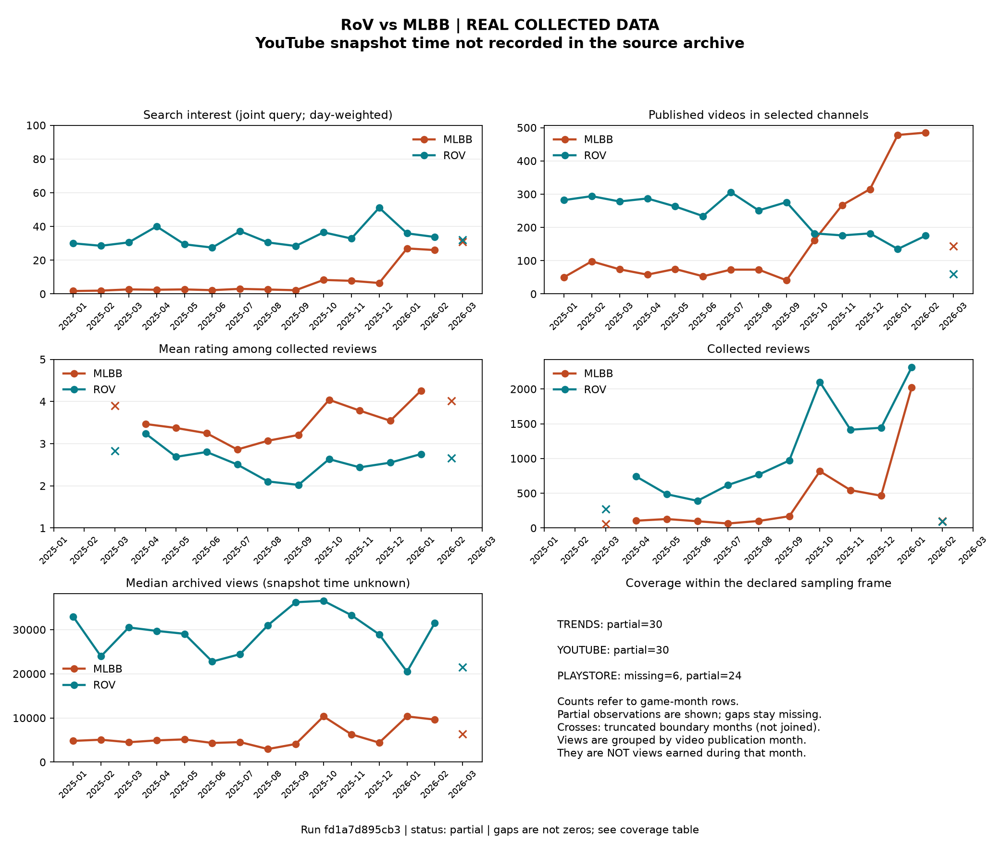

# RoV vs MLBB - run report

**REAL COLLECTED DATA**

- Run: `fd1a7d895cb3477ea72591e4199e5e38`
- Status: **partial**
- Processing finished: `2026-11-02T15:29:35.896947+00:00` (collection times are stored per source in the dataset)
- Full metrics: [CSV](../summary/monthly_game_metrics.csv), [Parquet](../summary/monthly_game_metrics.parquet)
- Provenance and quality: [manifest](../manifest.json)

## Observations

MLBB: 4,675 reviews observed in the selected time window. This is a collected sample, not a count of players.

ROV: 11,613 reviews observed in the selected time window. This is a collected sample, not a count of players.

Cross-source conclusions require checking coverage and query scope before comparison. This report does not infer migration or causality.

## Source timing

An upper bound is not an exact collection time. Export time is the time the archive was copied, not the time views or ratings were originally fetched.
Archived YouTube values with unknown collection time are descriptive snapshot values; do not treat them as current views or age-adjusted performance.

| Source | Original collection time | Collected no later than (bound only) | Archive exported at |
|---|---|---|---|
| trends | 2026-11-02T15:26:51.407431+00:00 | - | - |
| youtube | unknown / unavailable | 2026-03-16T07:51:01.117452+00:00 | 2026-11-02T15:21:52.012858+00:00 |
| playstore | unknown / unavailable | 2026-03-17T09:42:59.316150+00:00 | 2026-11-02T15:21:48.600290+00:00 |

## Quality accounting

| Source | Input rows | Accepted | Exact duplicates | Rejected |
|---|---:|---:|---:|---:|
| trends | 126 | 124 | 0 | 2 |
| youtube | 5826 | 5826 | 0 | 0 |
| playstore | 16288 | 16288 | 0 | 0 |

## Monthly coverage

`complete` means complete within the declared sampling frame, not the entire population.
`filtered` indicates rejected records; `partial` indicates incomplete time/pagination/interval coverage.
Missing/unknown counts remain null; zero requires documented complete coverage with no matching records.

| Month | Game | Trends | YouTube | Play Store |
|---|---|---|---|---|
| 2025-01 | rov | partial | partial | missing |
| 2025-01 | mlbb | partial | partial | missing |
| 2025-02 | rov | partial | partial | missing |
| 2025-02 | mlbb | partial | partial | missing |
| 2025-03 | rov | partial | partial | partial |
| 2025-03 | mlbb | partial | partial | partial |
| 2025-04 | rov | partial | partial | partial |
| 2025-04 | mlbb | partial | partial | partial |
| 2025-05 | rov | partial | partial | partial |
| 2025-05 | mlbb | partial | partial | partial |
| 2025-06 | rov | partial | partial | partial |
| 2025-06 | mlbb | partial | partial | partial |
| 2025-07 | rov | partial | partial | partial |
| 2025-07 | mlbb | partial | partial | partial |
| 2025-08 | rov | partial | partial | partial |
| 2025-08 | mlbb | partial | partial | partial |
| 2025-09 | rov | partial | partial | partial |
| 2025-09 | mlbb | partial | partial | partial |
| 2025-10 | rov | partial | partial | partial |
| 2025-10 | mlbb | partial | partial | partial |
| 2025-11 | rov | partial | partial | partial |
| 2025-11 | mlbb | partial | partial | partial |
| 2025-12 | rov | partial | partial | partial |
| 2025-12 | mlbb | partial | partial | partial |
| 2026-01 | rov | partial | partial | partial |
| 2026-01 | mlbb | partial | partial | partial |
| 2026-02 | rov | partial | partial | partial |
| 2026-02 | mlbb | partial | partial | partial |
| 2026-03 | rov | partial | partial | missing |
| 2026-03 | mlbb | partial | partial | missing |

## Interpretation limits

- Search interest is a normalized index within one joint query, not search volume or player count.
- Weekly Trends values are weighted by overlapping days when summarized by month; this is an approximation, not recovered daily observations.
- Video views are cumulative at collection, grouped by publication month. Older videos have had more time to accumulate views.
- Reviews represent the accessible storefront/language request and filtering rules. Request language does not establish nationality.
- A before/after comparison alone does not identify the cause of a change.
