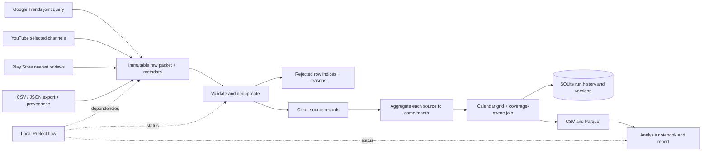

# Architecture

## Consistency boundaries

- Separate sample and real artifact roots and SQLite metadata prevent accidental mixing.
- An OS-level file lock admits one writer per artifact namespace. A dead process releases the lock automatically.
- A run is first committed as `running`. Under the exclusive lock, prior orphaned `running` rows become `failed`.
- Raw bytes are stored before parsing. Each run has a unique directory; no previous raw file is overwritten.
- Clean observations, run membership, metrics and final DB status are committed in a single SQLite transaction.
- The content-version key `(source, record_key, payload_hash)` reuses identical records across reruns while keeping changed values available to old runs.
- Export consumers use an explicit run manifest or an atomic `latest_complete.json` pointer. A failed/partial run cannot replace the complete pointer.
- SQLite and filesystem writes are not a single distributed transaction. If the process dies after the DB commit but before pointer replacement, the pointer may lag; the explicit committed run remains recoverable. A retry safely produces a new run.
- An observed pointer-write exception after commit returns an error to the caller and records a diagnostic, while preserving the committed DB status. It is not incorrectly relabeled as a rolled-back run. The preceding complete pointer may remain current until a safe rerun.

## Orchestration

`batch_flow`: validate/integrate/persist → render report.

`refresh_flow`: bounded collection → validate/integrate/persist → render report.

Transient HTTP/network failures retry with bounded exponential delays. Missing credentials, invalid schemas and invalid data are not blindly retried. Collection failure records its own batch status and stops a refresh flow before publication. Review library errors are explicitly intercepted because its public helper can otherwise return an empty list after an upstream error.

## Why SQLite

SQLite is local, inspectable and does not depend on a teammate's account. Its transactions and unique keys are enough for this single-writer portfolio dataset. Raw files and analytic exports remain independent of the database. A future migration can replace the storage module without changing the data contracts, but no cloud migration is needed for this scope.
